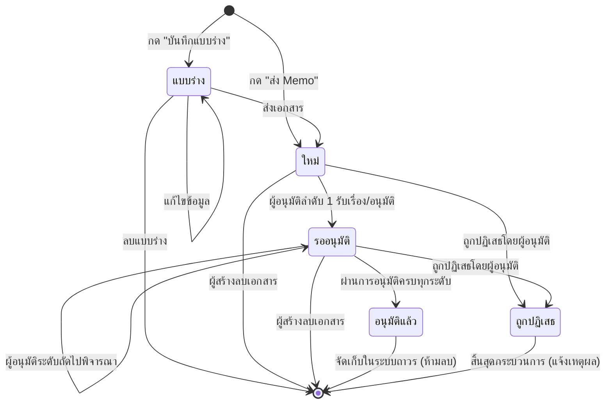

# 📘 คู่มือการใช้งานระบบ Memo-Hub ฉบับสมบูรณ์ (Official User Manual)

---

## สารบัญ (Table of Contents)

1. [บทนำและภาพรวมระบบ (System Overview)](#1-บทนำและภาพรวมระบบ-system-overview)
2. [สิทธิ์และหน้าที่ของผู้ใช้งาน (Roles & Permission Matrix)](#2-สิทธิ์และหน้าที่ของผู้ใช้งาน-roles--permission-matrix)
3. [การเข้าสู่ระบบและความปลอดภัย (Authentication & Security)](#3-การเข้าสู่ระบบและความปลอดภัย-authentication--security)
4. [วงจรชีวิตและสถานะของเอกสาร (Document Lifecycle & Status Reference)](#4-วงจรชีวิตและสถานะของเอกสาร-document-lifecycle--status-reference)
5. [คู่มือสำหรับผู้ใช้งานทั่วไป: การสร้างและจัดการ Memo (User & Creator Guide)](#5-คู่มือสำหรับผู้ใช้งานทั่วไป-การสร้างและจัดการ-memo-user--creator-guide)
   - 5.1 [หน้าหลัก (Home Page) และการค้นหา/กรองข้อมูล](#51-หน้าหลัก-home-page-และการค้นหากรองข้อมูล)
   - 5.2 [ขั้นตอนการสร้าง Memo ใหม่ (Create Memo)](#52-ขั้นตอนการสร้าง-memo-ใหม่-create-memo)
   - 5.3 [การจัดการแบบร่าง (Draft Management)](#53-การจัดการแบบร่าง-draft-management)
   - 5.4 [การคัดลอกเอกสาร (Duplicate Feature)](#54-การคัดลอกเอกสาร-duplicate-feature)
   - 5.5 [การตรวจสอบสถานะและประวัติการอนุมัติ (Tracking & History)](#55-การตรวจสอบสถานะและประวัติการอนุมัติ-tracking--history)
   - 5.6 [การสั่งพิมพ์และบันทึกเป็น PDF (Print & Export)](#56-การสั่งพิมพ์และบันทึกเป็น-pdf-print--export)
   - 5.7 [การลบเอกสารและข้อกำหนดความปลอดภัย (Deletion Policy)](#57-การลบเอกสารและข้อกำหนดความปลอดภัย-deletion-policy)
6. [คู่มือสำหรับผู้มีสิทธิ์อนุมัติ: การตรวจสอบและพิจารณาเอกสาร (Approver Guide)](#6-คู่มือสำหรับผู้มีสิทธิ์อนุมัติ-การตรวจสอบและพิจารณาเอกสาร-approver-guide)
   - 6.1 [การเข้าถึงคิวงานรออนุมัติ (Pending Approval Queue)](#61-การเข้าถึงคิวงานรออนุมัติ-pending-approval-queue)
   - 6.2 [การตรวจสอบเนื้อหาและสายการอนุมัติ (Document Inspection)](#62-การตรวจสอบเนื้อหาและสายการอนุมัติ-document-inspection)
   - 6.3 [วิธีการอนุมัติเอกสาร (Approve Action)](#63-วิธีการอนุมัติเอกสาร-approve-action)
   - 6.4 [วิธีการปฏิเสธเอกสาร (Reject Action)](#64-วิธีการปฏิเสธเอกสาร-reject-action)
   - 6.5 [การอนุมัติแบบกลุ่มหลายรายการ (Batch Action)](#65-การอนุมัติแบบกลุ่มหลายรายการ-batch-action)
   - 6.6 [การติดตามกำหนดเวลาและการเตือน Deadline](#66-การติดตามกำหนดเวลาและการเตือน-deadline)
7. [คู่มือสำหรับผู้ดูแลระบบ (System Administrator Guide)](#7-คู่มือสำหรับผู้ดูแลระบบ-system-administrator-guide)
   - 7.1 [แดชบอร์ดรายงานและสถิติ (Executive Dashboard)](#71-แดชบอร์ดรายงานและสถิติ-executive-dashboard)
   - 7.2 [การจัดการผู้ใช้งานและการนำเข้าข้อมูล (User Management & Import)](#72-การจัดการผู้ใช้งานและการนำเข้าข้อมูล-user-management--import)
   - 7.3 [การจัดการข้อมูลหลัก (Master Data Management)](#73-การจัดการข้อมูลหลัก-master-data-management)
   - 7.4 [การออกแบบและแก้ไขแบบฟอร์มเทมเพลต (Template Builder)](#74-การออกแบบและแก้ไขแบบฟอร์มเทมเพลต-template-builder)
   - 7.5 [การตั้งค่าระบบอีเมล SMTP และเนื้อหาแจ้งเตือน (Email Settings)](#75-การตั้งค่าระบบอีเมล-smtp-และเนื้อหาแจ้งเตือน-email-settings)
   - 7.6 [การกำหนดนโยบาย Deadline (Deadline Policy)](#76-การกำหนดนโยบาย-deadline-deadline-policy)
   - 7.7 [การแก้ไขเนื้อหาคู่มือการใช้งานในระบบ (Manual Content Editor)](#77-การแก้ไขเนื้อหาคู่มือการใช้งานในระบบ-manual-content-editor)
   - 7.8 [การตรวจสอบประวัติระบบและบันทึกการทำงาน (Audit & System Logs)](#78-การตรวจสอบประวัติระบบและบันทึกการทำงาน-audit--system-logs)
8. [คำถามที่พบบ่อยและการแก้ไขปัญหาเบื้องต้น (FAQ & Troubleshooting)](#8-คำถามที่พบบ่อยและการแก้ไขปัญหาเบื้องต้น-faq--troubleshooting)

---

## 1. บทนำและภาพรวมระบบ (System Overview)

**Memo-Hub** คือระบบบริหารจัดการเอกสารบันทึกข้อความภายในองค์กร (Electronic Internal Memorandum & Workflow Approval System) ออกแบบมาเพื่อทดแทนกระบวนการเดินเอกสารในรูปแบบกระดาษ (Paperless) ลดความล่าช้าในการส่งต่อสายงาน และเพิ่มความโปร่งใสตรวจสอบได้ของประวัติการอนุมัติทุกขั้นตอน

### จุดเด่นสำคัญของระบบ:
* **Real-time Synchronization:** อัปเดตข้อมูลแบบทันทีผ่านฐานข้อมูลคลาวด์ Firestore ไม่ต้องกดรีเฟรชหน้าจอ
* **Dual Approval Channel:** รองรับการอนุมัติทั้งจากหน้าเว็บไซต์ของระบบโดยตรง และการกดอนุมัติ/ปฏิเสธแบบ 1-คลิกผ่านอีเมลแจ้งเตือนโดยไม่ต้องล็อกอิน
* **Dynamic Template & Approval Grid:** รองรับแบบฟอร์มเอกสารหลากหลายประเภท พร้อมสร้างสายการอนุมัติตามระดับโครงสร้างองค์กรโดยอัตโนมัติ
* **In-app Editable Manual:** คู่มือการใช้งานระบบสามารถเปิดอ่านได้ทันทีผ่านไอคอน `?` บนแถบหน้าจอ และผู้ดูแลระบบสามารถปรับปรุงเนื้อหาคู่มือผ่านหน้าตั้งค่าได้แบบสด

---

## 2. สิทธิ์และหน้าที่ของผู้ใช้งาน (Roles & Permission Matrix)

ระบบ Memo-Hub จำแนกบทบาทและขอบเขตการทำงานของผู้ใช้งานออกเป็น 3 ระดับหลัก:

| สิทธิ์ / บทบาท | ผู้ใช้ทั่วไป (Creator) | ผู้มีสิทธิ์อนุมัติ (Approver) | ผู้ดูแลระบบ (Admin) |
|---|:---:|:---:|:---:|
| เข้าสู่ระบบและจัดการโปรไฟล์ส่วนตัว | ✅ | ✅ | ✅ |
| สร้าง Memo ใหม่ และบันทึกแบบร่าง (Draft) | ✅ | ✅ | ✅ |
| ดู/ค้นหา/กรอง Memo ของตนเอง | ✅ | ✅ | ✅ |
| แก้ไขและลบแบบร่างที่ตนเองสร้าง | ✅ | ✅ | ✅ |
| คัดลอกเอกสาร (Duplicate) เพื่อสร้างใหม่ | ✅ | ✅ | ✅ |
| สั่งพิมพ์และบันทึกไฟล์ PDF | ✅ | ✅ | ✅ |
| ลบ Memo ตนเองที่ยังไม่อนุมัติ (ใหม่/รออนุมัติ) | ✅ | ✅ | ✅ |
| ดูรายการ Memo ในสายงานที่ส่งมาขออนุมัติ | ❌ | ✅ | ✅ (ถ้าเป็นผู้อนุมัติ) |
| ทำการอนุมัติ (Approve) ผ่านเว็บและอีเมล | ❌ | ✅ | ✅ (ถ้าเป็นผู้อนุมัติ) |
| ทำการปฏิเสธ (Reject) พร้อมระบุเหตุผล | ❌ | ✅ | ✅ (ถ้าเป็นผู้อนุมัติ) |
| ดูหน้าแดชบอร์ดภาพรวมและสถิติระบบ | ❌ | ❌ | ✅ |
| จัดการรายชื่อผู้ใช้และระดับการอนุมัติ | ❌ | ❌ | ✅ |
| จัดการข้อมูลหลัก (แผนก, ตำแหน่ง, Dropdown) | ❌ | ❌ | ✅ |
| จัดการแบบฟอร์มเทมเพลต และหัวกระดาษบริษัท | ❌ | ❌ | ✅ |
| ตั้งค่า SMTP, อีเมลแจ้งเตือน และ Deadline | ❌ | ❌ | ✅ |
| แก้ไขเนื้อหาคู่มือการใช้งานในระบบ | ❌ | ❌ | ✅ |
| ดูบันทึกการทำงานของระบบ (Audit / Syslog) | ❌ | ❌ | ✅ |

---

## 3. การเข้าสู่ระบบและความปลอดภัย (Authentication & Security)

### ข้อมูลที่ใช้เข้าสู่ระบบ:
* **ชื่อผู้ใช้ (Username):** รหัสพนักงาน (เช่น `EMP001`, `100234`)
* **รหัสผ่าน (Password):** หมายเลขโทรศัพท์มือถือของผู้ใช้งาน (ตามที่ลงทะเบียนไว้ในฐานข้อมูล)

### ขั้นตอนการเข้าสู่ระบบ:
1. เปิดเว็บเบราว์เซอร์แล้วเข้าสู่ URL ของระบบ Memo-Hub (หน้าจอจะแสดงหน้าต่างเข้าสู่ระบบ `/auth/login`)
2. ป้อน **รหัสพนักงาน** และ **รหัสผ่าน** ลงในช่องที่กำหนด
3. คลิกปุ่ม **"เข้าสู่ระบบ"**

> [!NOTE]
> **การนำทางอัตโนมัติตามระดับสิทธิ์ (Role-based Routing):**
> * บัญชี **ผู้ใช้ทั่วไป และ ผู้มีสิทธิ์อนุมัติ (Non-Admin)** จะถูกนำทางไปยังหน้า **`/home`** ซึ่งออกแบบมาให้เน้นการทำงานรายวัน (สร้างเอกสาร, อนุมัติเอกสาร) อย่างกระชับและรวดเร็ว
> * บัญชี **ผู้ดูแลระบบ (Admin)** จะถูกนำทางไปยังหน้า **`/dashboard`** เพื่อติดตามภาพรวม สถิติ และการบริหารระบบ

### การออกจากระบบ (Sign Out):
* คลิกปุ่ม **"ออกจากระบบ"** ที่มุมขวาบนของแถบหัวหน้าเว็บ ระบบจะล้าง Session จากอุปกรณ์ และกลับไปยังหน้าล็อกอินเพื่อความปลอดภัย

---

## 4. วงจรชีวิตและสถานะของเอกสาร (Document Lifecycle & Status Reference)

เอกสารในระบบ Memo-Hub จะมีสถานะกำกับเสมอเพื่อบ่งบอกความคืบหน้าของกระบวนการ:



### รายละเอียดและสัญลักษณ์สถานะ:

| สัญลักษณ์ / Badge | รหัสสถานะ | ความหมายและผลกระทบของระบบ |
|---|:---:|---|
| 🩶 **แบบร่าง** | `draft` | เอกสารถูกบันทึกไว้ในระบบ แต่**ยังไม่ได้ส่ง**เข้าสู่สายการอนุมัติ ผู้อนุมัติจะไม่เห็นเอกสารนี้ ผู้สร้างสามารถกลับมาแก้ไขหรือลบทิ้งได้ตลอดเวลา |
| 🔵 **ใหม่** | `new` | เอกสารส่งเข้าสู่ระบบแล้ว ระบบทำการแจ้งเตือนอีเมลไปยังผู้อนุมัติระดับที่ 1 เรียบร้อย อยู่ในคิวรอการตรวจสอบ |
| 🟡 **รออนุมัติ** | `waiting` | เอกสารผ่านการตรวจรับหรืออนุมัติในระดับต้นแล้ว และอยู่ระหว่างรอการลงนามของผู้อนุมัติลำดับถัดไปตามสายงาน |
| 🟢 **อนุมัติแล้ว** | `approved` | เอกสารได้รับการอนุมัติอย่างสมบูรณ์ครบถ้วนทุกระดับ ระบบจะส่งอีเมลแจ้งผู้สร้าง และเอกสารถูกล็อกห้ามแก้ไขหรือลบ |
| 🔴 **ถูกปฏิเสธ** | `rejected` | มีผู้อนุมัติท่านใดท่านหนึ่งปฏิเสธเอกสาร กระบวนการจะหยุดลงทันที ระบบจะส่งอีเมลพร้อมระบุเหตุผลการปฏิเสธให้ผู้สร้างทราบ |

---

## 5. คู่มือสำหรับผู้ใช้งานทั่วไป: การสร้างและจัดการ Memo (User & Creator Guide)

### 5.1 หน้าหลัก (Home Page) และการค้นหา/กรองข้อมูล

เมื่อเข้าสู่ระบบด้วยบัญชีผู้ใช้งานทั่วไป คุณจะพบกับหน้าจอหลักที่มีแท็บ **"Memo ของฉัน"**:

```
+-----------------------------------------------------------------------------------------+
| [M] MemoHub   นายสมชาย ใจดี (ฝ่ายจัดซื้อ)                             [เลือก] [ออกจากระบบ] |
+-----------------------------------------------------------------------------------------+
| [📄 Memo ของฉัน  12]                                                [ ? คู่มือการใช้งาน ] |
|                                                                                         |
| +-------------------------------------------------------------------------------------+ |
| | Memo ของฉัน                 [ 🔍 ค้นหา... ] [ สถานะ: ทั้งหมด ▾ ] [ + สร้าง Memo ]   | |
| +-------------------------------------------------------------------------------------+ |
| | [ ] MEMO-2026-0045 | ขออนุมัติจัดซื้ออุปกรณ์คอมพิวเตอร์          [🟢 อนุมัติแล้ว]       | |
| |     สมชาย ใจดี • 19 ต.ค. 2026 10:30                                   [📋] [🖨️] [🗑️]   | |
| +-------------------------------------------------------------------------------------+ |
+-----------------------------------------------------------------------------------------+
```

* **ช่องค้นหา (Search Box):** พิมพ์เลขที่ Memo, ชื่อหัวข้อเอกสาร หรือชื่อผู้สร้าง เพื่อค้นหาได้ทันที
* **ตัวกรองสถานะ (Status Filter Dropdown):** เลือกกรองดูเฉพาะสถานะที่สนใจ เช่น เฉพาะ *แบบร่าง*, *ใหม่*, *รออนุมัติ*, หรือ *อนุมัติแล้ว*
* **ปุ่มไอคอน `?` คู่มือการใช้งาน:** อยู่บริเวณขวามือของแถบแท็บ คลิกเพื่อเปิดหน้าต่างคู่มือและดูขั้นตอนการใช้งานได้ทันที

---

### 5.2 ขั้นตอนการสร้าง Memo ใหม่ (Create Memo)

1. คลิกปุ่ม **"+ สร้าง Memo"** ที่มุมขวาบนของตาราง
2. หน้าจอแบบฟอร์มเอกสารเต็มหน้าจอ (`MemoDocumentForm`) จะปรากฏขึ้น
3. **ขั้นตอนที่ 1 — เลือก Template:** 
   * เลือกประเภทของแบบฟอร์มที่ต้องการ เช่น *ใบขออนุมัติจัดซื้อ (Purchasing Memo)*, *ใบขอเบิกค่าใช้จ่าย*, หรือ *หนังสือบันทึกข้อความทั่วไป*
4. **ขั้นตอนที่ 2 — กรอกข้อมูลในแบบฟอร์ม:**
   * กรอกรายละเอียดตามช่องข้อมูลที่แบบฟอร์มกำหนด
   * ช่องที่มีเครื่องหมายดอกจันสีแดง <span style="color:red; font-weight:bold;">*</span> เป็นช่องข้อมูลบังคับ ต้องระบุข้อมูลให้ครบถ้วน
   * Dropdown ต่างๆ (เช่น แผนก, ตำแหน่ง, ซัพพลายเออร์, ลูกค้า) สามารถคลิกเพื่อพิมพ์ค้นหา (Type-to-Search) เพื่อความสะดวกรวดเร็ว
5. **ขั้นตอนที่ 3 — ตรวจสอบตารางสายการอนุมัติ (Approval Grid):**
   * ระบบจะนำชื่อ ตำแหน่ง และแผนกของคุณ มาแสดงในช่อง **"ผู้ขออนุมัติ"** โดยอัตโนมัติ
   * สายการอนุมัติในช่องถัดไป (เช่น ผู้ตรวจสอบ, ผู้จัดการฝ่าย, กรรมการผู้จัดการ) จะถูกสร้างขึ้นตามโครงสร้างที่ระบบตั้งค่าไว้
6. **ขั้นตอนที่ 4 — เลือกการดำเนินการ:**
   * **กดปุ่ม "ส่ง Memo" (สีน้ำเงิน):** เอกสารจะถูกส่งเข้าสู่ระบบทันที สถานะจะกลายเป็น 🔵 **ใหม่** และระบบจะจัดส่งอีเมลแจ้งเตือนพร้อมแนบลิงก์อนุมัติไปยังผู้อนุมัติลำดับแรก
   * **กดปุ่ม "บันทึกแบบร่าง" (สีเทา):** บันทึกข้อมูลที่กรอกไว้ชั่วคราว สถานะจะเป็น 🩶 **แบบร่าง** โดยจะยังไม่มีการส่งเอกสารหรือแจ้งเตือนใดๆ ไปยังผู้อนุมัติ

---

### 5.3 การจัดการแบบร่าง (Draft Management)

หากคุณบันทึกเอกสารไว้เป็นแบบร่าง และต้องการนำกลับมาทำงานต่อ:
1. ไปที่แท็บ **"Memo ของฉัน"** และค้นหาเอกสารที่มีป้ายกำกับ 🩶 **แบบร่าง**
2. **แก้ไขแบบร่าง:** คลิกปุ่ม **"แก้ไข"** (หรือไอคอนดินสอ ✏️)
   * แบบฟอร์มจะเปิดขึ้นมาพร้อมข้อมูลเดิมทั้งหมดที่คุณเคยกรอกไว้
   * ปรับแก้เนื้อหาตามต้องการ แล้วเลือกว่าจะกด **"ส่ง Memo"** หรือ **"บันทึกแบบร่าง"** อีกครั้ง
3. **ลบแบบร่าง:** หากไม่ต้องการใช้งานแล้ว สามารถคลิก **ไอคอนถังขยะสีแดง 🗑️** เพื่อลบแบบร่างทิ้งได้ทันที

---

### 5.4 การคัดลอกเอกสาร (Duplicate Feature)

ในกรณีที่คุณต้องออกเอกสาร Memo ที่มีเนื้อหาคล้ายคลึงกับเอกสารเดิมที่เคยทำไปแล้ว:
1. หาแถวรายการเอกสารเดิมที่ต้องการต้นแบบ
2. คลิก **ปุ่มคัดลอก (ไอคอน 📋 Copy)** บนแถวรายการ
3. ระบบจะเปิดหน้าต่างสร้างเอกสารใหม่ขึ้นมา โดยคัดลอกข้อมูลในช่องกรอกเอกสารเดิมมาใส่ให้ทั้งหมดโดยอัตโนมัติ
4. *สิ่งที่ระบบจะ Reset ให้ใหม่เพื่อความถูกต้อง:*
   * เลขที่เอกสาร (Memo Number) ใหม่
   * วันที่สร้างเอกสารใหม่
   * สถานะจะเริ่มต้นใหม่ และตาราง Approval Grid จะถูกกำหนดค่าใหม่
5. คุณเพียงแค่ตรวจสอบ แก้ไขจุดที่ต้องการเปลี่ยนแปลง แล้วกด **"ส่ง Memo"** ได้ทันที ช่วยประหยัดเวลาอย่างมาก

---

### 5.5 การตรวจสอบสถานะและประวัติการอนุมัติ (Tracking & History)

* **การเปิดดูรายละเอียด:** คลิกที่แถวรายการ Memo เพื่อเปิดดูหน้าต่างรายละเอียดเอกสารฉบับเต็ม
* **ข้อมูลที่สามารถตรวจสอบได้:**
  * ข้อมูลหัวเอกสาร: เลขที่เอกสาร, วันที่, ฝ่ายที่ขอ, ผู้ขออนุมัติ
  * เนื้อหาและรายการแนบทั้งหมด
  * **ประวัติสายการอนุมัติ (Approval Chain):** แสดงลำดับขั้นการอนุมัติ, รายชื่อผู้ลงนาม, วันและเวลาที่อนุมัติ
  * ในกรณีที่เอกสารถูกปฏิเสธ ระบบจะแสดงกรอบข้อความสีแดงระบุชื่อผู้อนุมัติที่ปฏิเสธ พร้อม **"เหตุผลในการปฏิเสธ"** ไว้อย่างชัดเจน

---

### 5.6 การสั่งพิมพ์และบันทึกเป็น PDF (Print & Export)

1. คลิกที่ **ไอคอนเครื่องพิมพ์ 🖨️** บนแถวรายการ Memo ที่ต้องการ
2. ระบบจะจัดหน้ากระดาษตามมาตรฐานเอกสารทางการ นำตราโลโก้บริษัท หัวกระดาษ เนื้อหา และตารางลายเซ็นการอนุมัติมาประกอบกัน
3. หน้าต่างตัวอย่างการพิมพ์ของเบราว์เซอร์จะเปิดขึ้นโดยอัตโนมัติ:
   * สามารถเลือกพิมพ์ออกเครื่องพิมพ์ (Physical Printer)
   * หรือเลือกบันทึกเป็นไฟล์ PDF (Save as PDF) ลงในคอมพิวเตอร์ของคุณ

---

### 5.7 การลบเอกสารและข้อกำหนดความปลอดภัย (Deletion Policy)

> [!IMPORTANT]
> **นโยบายการลบเอกสารของ Memo-Hub:**
> * ผู้ใช้ทั่วไปสามารถลบเอกสารได้**เฉพาะเอกสารที่ตนเองเป็นผู้สร้างขึ้นเท่านั้น**
> * ลบได้เฉพาะเอกสารที่มีสถานะ: 🩶 **แบบร่าง (Draft)**, 🔵 **ใหม่ (New)**, หรือ 🟡 **รออนุมัติ (Waiting)**
> * **ห้ามลบเอกสารที่สถานะเป็น 🟢 "อนุมัติแล้ว (Approved)":** เอกสารที่ผ่านการอนุมัติสมบูรณ์ถือเป็นเอกสารสำคัญขององค์กร ระบบจะปิดปุ่มลบเพื่อป้องกันการทำลายหลักฐานและประวัติการทำงาน

**ขั้นตอนการลบ:**
1. คลิกไอคอนถังขยะสีแดง 🗑️ บนแถวรายการที่ต้องการลบ
2. ระบบจะแสดงกล่องข้อความยืนยันการลบ
3. คลิก **"ยืนยัน"** เพื่อลบเอกสาร (เอกสารที่ลบแล้วจะไม่สามารถกู้คืนได้)

---

## 6. คู่มือสำหรับผู้มีสิทธิ์อนุมัติ: การตรวจสอบและพิจารณาเอกสาร (Approver Guide)

ผู้ใช้งานที่มีสิทธิ์อนุมัติ (Approver / Checker) สามารถทำทุกฟังก์ชันที่ผู้ใช้ทั่วไปทำได้ และมีส่วนการทำงานเพิ่มขึ้นสำหรับบริหารจัดการคิวการอนุมัติ

### 6.1 การเข้าถึงคิวงานรออนุมัติ (Pending Approval Queue)

เมื่อล็อกอินเข้าสู่ระบบด้วยบัญชี Approver ในหน้า `/home` คุณจะพบแท็บ **"รายการทั้งหมด"** (หรือแท็บคิวงานอนุมัติ):

```
+-----------------------------------------------------------------------------------------+
| [M] MemoHub   นายวิชัย ผู้จัดการฝ่าย (ฝ่ายไอที)                       [เลือก] [ออกจากระบบ] |
+-----------------------------------------------------------------------------------------+
| [🕒 รายการทั้งหมด  5]  [📄 Memo ของฉัน  2]                           [ ? คู่มือการใช้งาน ] |
|                                                                                         |
| +-------------------------------------------------------------------------------------+ |
| | รายการทั้งหมด   [ 🔍 ค้นหา... ]  (รออนุมัติ 3) (อนุมัติแล้ว 12) (ถูกปฏิเสธ 1) (เลยเวลา 0)| |
| +-------------------------------------------------------------------------------------+ |
| | [ ] MEMO-2026-0048 | ขอจัดซื้อ Server สำรองข้อมูล                       [🟡 รออนุมัติ] | |
| |     สมเกียรติ มั่นคง • 20 ต.ค. 2026 09:15                      [✅ อนุมัติ] [❌ ปฏิเสธ] | |
| +-------------------------------------------------------------------------------------+ |
+-----------------------------------------------------------------------------------------+
```

* **แท็กตัวกรองด่วนด้านบน:**
  * **รออนุมัติ (Pending):** แสดงเฉพาะเอกสารที่รอให้คุณเป็นผู้พิจารณาลงนาม
  * **อนุมัติแล้ว (Approved):** เอกสารที่คุณเคยลงนามอนุมัติไปแล้ว
  * **ถูกปฏิเสธ (Rejected):** เอกสารที่ถูกปฏิเสธในสายงาน
  * **เลยเวลา (Overdue):** เอกสารที่ใกล้หรือเกินกำหนด Deadline ของระบบ

---

### 6.2 การตรวจสอบเนื้อหาและสายการอนุมัติ (Document Inspection)

ก่อนตัดสินใจลงนามอนุมัติหรือปฏิเสธ คุณควรตรวจสอบความถูกต้องของเอกสาร:
1. คลิกที่ชื่อเรื่องหรือแถวของ Memo ที่ต้องการตรวจ
2. หน้าต่างรายละเอียดเอกสารจะแสดงเนื้อหาและตารางสายงานการอนุมัติ
3. ตรวจสอบดูว่าผู้ขออนุมัติคือใคร วัตถุประสงค์ ยอดเงิน และเอกสารแนบถูกต้องครบถ้วนหรือไม่

---

### 6.3 วิธีการอนุมัติเอกสาร (Approve Action)

ระบบเปิดให้ผู้อนุมัติสามารถดำเนินการได้ผ่าน 2 ช่องทางที่สะดวก:

#### ช่องทางที่ 1: อนุมัติผ่านหน้าเว็บไซต์ Memo-Hub
1. ในหน้า **"รายการทั้งหมด"** ให้หาเอกสารที่ต้องการอนุมัติ
2. คลิกปุ่ม **"อนุมัติ"** (เครื่องหมายถูกสีเขียว ✅)
3. ระบบจะแสดงหน้าต่างยืนยันการอนุมัติ
4. คลิก **"ยืนยันการอนุมัติ"**

#### ช่องทางที่ 2: อนุมัติแบบ 1-คลิกผ่านอีเมล (Direct Email Approval)
1. เมื่อมีเอกสารส่งมาถึงลำดับของคุณ ระบบจะส่งอีเมลแจ้งเตือนไปยังอีเมลของคุณ
2. ภายในเนื้อหาอีเมลจะมีสรุปข้อมูล Memo พร้อมปุ่มดำเนินการ 2 ปุ่ม: **[ อนุมัติเอกสาร ]** และ **[ ปฏิเสธเอกสาร ]**
3. คลิกปุ่ม **"อนุมัติเอกสาร"** ในอีเมล
4. ระบบจะประมวลผลการอนุมัติให้โดยอัตโนมัติทันทีผ่าน Secure Action Token **โดยที่คุณไม่ต้องล็อกอินเข้าสู่ระบบ**

> [!TIP]
> **การส่งต่อสายงานอัตโนมัติ (Sequential Routing):**
> ทันทีที่คุณอนุมัติสำเร็จ หากเอกสารนั้นมีผู้อนุมัติลำดับถัดไป (เช่น ผู้บริหารระดับสูงขึ้นไป) ระบบจะเปลี่ยนส่งต่อคิวงานและส่งอีเมลแจ้งเตือนไปยังผู้อนุมัติท่านถัดไปทันที และเมื่อถึงลำดับสุดท้าย เอกสารจะเปลี่ยนสถานะเป็น 🟢 **อนุมัติแล้ว** พร้อมแจ้งเตือนผู้สร้างเอกสารทราบ

---

### 6.4 วิธีการปฏิเสธเอกสาร (Reject Action)

หากตรวจสอบพบว่าข้อมูลไม่ถูกต้อง หรือไม่ผ่านเกณฑ์การพิจารณา:

#### ผ่านหน้าเว็บไซต์:
1. คลิกปุ่ม **"ปฏิเสธ"** (เครื่องหมายกากบาทสีแดง ❌) บนแถวรายการ Memo
2. **กล่องข้อความปฏิเสธเอกสารจะปรากฏขึ้น (บังคับกรอกเหตุผล):**
   * ป้อนเหตุผลในการปฏิเสธ เช่น *"งบประมาณประจำไตรมาสไม่เพียงพอ"*, *"กรุณาแนบใบเสนอราคาเปรียบเทียบ 3 เจ้า"*
   * *หมายเหตุ: ปุ่มยืนยันจะใช้งานไม่ได้จนกว่าจะมีการพิมพ์เหตุผล*
3. คลิกปุ่ม **"ยืนยันปฏิเสธ"**

#### ผ่านอีเมล:
1. คลิกปุ่ม **"ปฏิเสธเอกสาร"** ในอีเมลแจ้งเตือน
2. ระบบจะเปิดหน้าต่างให้ระบุเหตุผลการปฏิเสธ
3. กรอกเหตุผลแล้วกดยืนยัน

> [!WARNING]
> เมื่อเอกสารถูกปฏิเสธ สถานะของเอกสารจะเปลี่ยนเป็น 🔴 **ถูกปฏิเสธ (Rejected)** ทันที กระบวนการจะหยุดลง และระบบจะส่งอีเมลพร้อมแนบเหตุผลที่ระบุไว้ส่งตรงถึงผู้สร้างเอกสาร

---

### 6.5 การอนุมัติแบบกลุ่มหลายรายการ (Batch Action)

ในกรณีที่มีเอกสารรออนุมัติจำนวนมาก:
1. คลิกปุ่ม **"เลือก"** ที่มุมขวาบนของตาราง
2. กล่อง Checkbox จะปรากฏขึ้นหน้าทุกแถวรายการ
3. ติ๊กเครื่องหมายถูกหน้ารายการ Memo ที่ต้องการ หรือคลิกเลือกทั้งหมด
4. ปุ่มคำสั่งแบบกลุ่มจะปรากฏขึ้นที่แถบด้านบน ให้คลิกดำเนินการเพื่ออนุมัติพร้อมกันในคราวเดียว

---

### 6.6 การติดตามกำหนดเวลาและการเตือน Deadline

* ระบบจะมีการคำนวณวันหมดอายุของแต่ละ Memo โดยนับจากวันที่สร้างเอกสารบวกกับจำนวนวัน Deadline ที่ Admin กำหนดไว้ (ค่าเริ่มต้นคือ 7 วัน)
* หากเอกสารใดเหลือเวลาพิจารณาน้อยกว่าหรือเท่ากับ 3 วัน ระบบจะขึ้นแถบสีเตือน
* ผู้อนุมัติสามารถคลิกแท็ก **"เลยเวลา"** เพื่อดูรายการเอกสารที่เกินกำหนดเวลาและจำเป็นต้องเร่งดำเนินการ

---

## 7. คู่มือสำหรับผู้ดูแลระบบ (System Administrator Guide)

ผู้ดูแลระบบสามารถเข้าถึงหน้าเมนูบริหารจัดการส่วนกลางผ่านลิงก์ **`/dashboard`** หรือกดปุ่ม **"Admin"** ที่มุมขวาบนของหน้าเว็บ

### 7.1 แดชบอร์ดรายงานและสถิติ (Executive Dashboard)

หน้าแดชบอร์ดสรุปภาพรวมการทำงานของทั้งระบบ:
* **การ์ดสรุปตัวเลข (Summary Cards):** จำนวน Memo ทั้งหมด, จำนวนเอกสารใหม่, รออนุมัติ, อนุมัติสำเร็จ, และถูกปฏิเสธ
* **Status Donut Chart:** แผนภูมิวงกลมแสดงสัดส่วนเปอร์เซ็นต์ของสถานะเอกสารในระบบ
* **Creation Trend Chart:** แผนภูมิแท่งแสดงแนวโน้มปริมาณการสร้าง Memo ย้อนหลัง 8 สัปดาห์
* **Recent Activity Feed:** รายการเคลื่อนไหวล่าสุดของระบบ เช่น ใครสร้างเอกสาร ใครลงนามอนุมัติ

---

### 7.2 การจัดการผู้ใช้งานและการนำเข้าข้อมูล (User Management & Import)

**เมนู: การตั้งค่า (Settings) → แท็บ "ผู้ใช้"**

1. **การเพิ่มผู้ใช้งานรายบุคคล:**
   * คลิกปุ่ม **"+ เพิ่มผู้ใช้"**
   * กำหนดรหัสพนักงาน (Username), รหัสผ่าน (เบอร์โทร), ชื่อ-นามสกุล, อีเมล, แผนก และตำแหน่ง
   * กำหนดสิทธิ์บทบาท: `User` หรือ `Admin`
   * สิทธิ์การอนุมัติ: ติ๊กเครื่องหมายถูกที่ **"เป็นผู้อนุมัติ (Approver)"** หากต้องการให้บัญชีนี้สามารถลงนามได้
2. **การนำเข้าผู้ใช้จาก Google Sheets (Sheet Import):**
   * รองรับการเชื่อมต่อกับ Google Sheet เพื่อนำเข้ารายชื่อพนักงานทั้งบริษัทพร้อมกันในคลิกเดียว
   * คลิกปุ่ม **"นำเข้าจาก Sheet"**
   * ระบุ Sheet ID, GID และช่วงคอลัมน์ จากนั้นกดตรวจสอบตัวอย่างข้อมูลและกดยืนยันการนำเข้า

---

### 7.3 การจัดการข้อมูลหลัก (Master Data Management)

**เมนู: การตั้งค่า (Settings) → แท็บ "ข้อมูลหลัก"**

หน้านี้ใช้สำหรับควบคุมตัวเลือกที่ปรากฏใน Dropdown ต่างๆ ในแบบฟอร์มการสร้าง Memo:
* รายชื่อ **ตำแหน่ง (Positions)**
* รายชื่อ **แผนก (Departments)**
* ข้อมูลจำเพาะลูกค้า (Client-specific options)
* ข้อมูลจำเพาะซัพพลายเออร์ (Vendor-specific options)
* ข้อมูลจำเพาะฝ่ายธุรการ/ภายใน (DF Internal Affairs options)

> [!TIP]
> ระบบมีกลไกป้องกันข้อมูลซ้ำซ้อน (Duplicate Detection) โดยจะตรวจสอบตัวสะกดและตัดช่องว่างให้อัตโนมัติ หากมีตัวเลือกนั้นอยู่แล้วระบบจะแจ้งเตือนและป้องกันการบันทึกซ้ำ

---

### 7.4 การออกแบบและแก้ไขแบบฟอร์มเทมเพลต (Template Builder)

**เมนู: การตั้งค่า (Settings) → แท็บ "เทมเพลต"**

Admin สามารถปรับแต่งและสร้างแบบฟอร์ม Memo ได้อย่างอิสระ:
1. **การตั้งค่าหัวกระดาษบริษัท (Company Header):**
   * กำหนด URL โลโก้องค์กร
   * กำหนดชื่อบริษัท (ไทย/อังกฤษ) และที่อยู่ สำหรับแสดงบนหัวเอกสารและ PDF
2. **การจัดการ Sections และ Fields:**
   * เพิ่ม/ลบ ส่วนข้อมูลในแบบฟอร์ม (เช่น ส่วนข้อมูลทั่วไป, ส่วนตารางรายการสินค้า, ส่วนสรุปยอดเงิน)
   * กำหนดประเภทฟิลด์: ข้อความสั้น, ข้อความยาว, ตัวเลข, วันที่, Dropdown
   * กำหนดความกว้างของฟิลด์ (เต็มบรรทัด หรือ ครึ่งบรรทัด) และกำหนดว่าเป็นฟิลด์บังคับกรอกหรือไม่
3. **การคัดลอกเทมเพลต (Duplicate Template):** สามารถกดคัดลอกเทมเพลตเดิมมาปรับแต่งเป็นแบบฟอร์มใหม่ได้ทันที

---

### 7.5 การตั้งค่าระบบอีเมล SMTP และเนื้อหาแจ้งเตือน (Email Settings)

**เมนู: การตั้งค่า (Settings) → แท็บ "ตั้งค่าอีเมล"**

1. **การเชื่อมต่อ SMTP Server:**
   * ระบุ SMTP Host, Port (เช่น 587 หรือ 465), การเข้ารหัส SSL/TLS
   * ระบุบัญชีผู้ใช้อีเมล (Username) และรหัสผ่านแอปพลิเคชัน (App Password)
   * ระบุชื่อและอีเมลผู้ส่ง (From Name / From Email)
   * มีปุ่ม **"ทดสอบส่งอีเมล (Test Email)"** เพื่อตรวจสอบความถูกต้องของการเชื่อมต่อก่อนใช้งานจริง
2. **การปรับแต่งรูปแบบข้อความอีเมล (Email Templates):**
   * กำหนดหัวข้ออีเมล (Subject) และเนื้อหา (Body) สำหรับกรณีต่างๆ:
     * แจ้งเตือนผู้อนุมัติเมื่อมีเอกสารใหม่มาถึง
     * แจ้งเตือนผู้สร้างเมื่อเอกสารได้รับการอนุมัติสมบูรณ์
     * แจ้งเตือนผู้สร้างเมื่อเอกสารถูกปฏิเสธ
   * รองรับ Parameter Tags อัตโนมัติ: `{memo_number}`, `{title}`, `{owner_name}`, `{action_label}`, `{actor_name}`, `{deadline}`

---

### 7.6 การกำหนดนโยบาย Deadline (Deadline Policy)

**เมนู: การตั้งค่า (Settings) → แท็บ "Deadline"**

* กำหนดจำนวนวันอายุสูงสุดของ Memo (ค่าเริ่มต้นคือ 7 วัน)
* ระบบพื้นหลัง (Scheduled Jobs) จะทำการตรวจเช็คเอกสารที่ค้างอยู่ในระบบ หากเกินกำหนดเวลาจะส่งผลต่อสถานะเอกสารและการเตือนในคิวงาน

---

### 7.7 การแก้ไขเนื้อหาคู่มือการใช้งานในระบบ (Manual Content Editor)

**เมนู: การตั้งค่า (Settings) → แท็บ "คู่มือการใช้งาน" (อยู่ถัดจากแท็บ Deadline)**

ฟีเจอร์นี้เปิดให้ Admin สามารถปรับปรุงเนื้อหาคู่มือที่แสดงในไอคอน `?` บนเว็บไซต์ได้ตลอดเวลา:
1. **การเลือกหมวดหมู่คู่มือที่จะแก้ไข:**
   * ปุ่มแท็บ **"คู่มือสำหรับ Approver"**
   * ปุ่มแท็บ **"คู่มือสำหรับ Creator"**
2. **ช่องพิมพ์เนื้อหา (Textarea Editor):**
   * พิมพ์เนื้อหาคู่มือตามต้องการ รองรับรูปแบบ:
     * `### หัวข้อ` ➔ แสดงเป็นการ์ดหัวข้อพร้อมเลขลำดับสวยงาม
     * `• ข้อความ` หรือ `- ข้อความ` ➔ แสดงเป็นรายการจุด Bullet
     * `**ข้อความ**` ➔ แสดงเป็นตัวหนา
3. **ปุ่มดูตัวอย่าง (Live Preview):**
   * คลิกปุ่ม **"ดูตัวอย่างผลลัพธ์"** เพื่อดูหน้าต่างจำลองว่าผู้ใช้งานจะมองเห็นอย่างไรก่อนบันทึกจริง
4. **ปุ่มรีเซ็ตเป็นค่าเริ่มต้น (Reset to Default):**
   * สามารถกดคืนค่ากลับเป็นคู่มือฉบับมาตรฐานของระบบได้ทุกเมื่อ
5. **การบันทึก (Save Manual):**
   * กดปุ่ม **"บันทึกคู่มือ"** ข้อมูลจะถูกซิงก์ขึ้น Firestore ทันที ผู้ใช้ที่เปิดอ่านคู่มืออยู่จะได้รับเนื้อหาใหม่แบบสดๆ โดยไม่ต้องรีโหลดหน้าเว็บ

---

### 7.8 การตรวจสอบประวัติระบบและบันทึกการทำงาน (Audit & System Logs)

* **Event Logs:** บันทึกประวัติกิจกรรมสำคัญในระบบ ใครเข้าสู่ระบบ ใครสร้าง Memo ใครแก้ไขการตั้งค่า พร้อม Timestamp ที่ละเอียด
* **Syslog:** บันทึกข้อความการทำงานระดับเซิร์ฟเวอร์ (Information, Warning, Error) สำหรับใช้วิเคราะห์และตรวจสอบปัญหาทางเทคนิค

---

## 8. คำถามที่พบบ่อยและการแก้ไขปัญหาเบื้องต้น (FAQ & Troubleshooting)

### Q1: เข้าสู่ระบบไม่ได้ ขึ้นข้อความว่า "ชื่อผู้ใช้หรือรหัสผ่านไม่ถูกต้อง"?
* **คำแนะนำ:** 
  1. ตรวจสอบว่าป้อนรหัสพนักงานถูกต้องหรือไม่ (ตัวพิมพ์ใหญ่-เล็กมีผล)
  2. รหัสผ่านเริ่มต้นคือหมายเลขโทรศัพท์มือถือที่ไม่มีขีดคั่น (เช่น `0812345678`)
  3. หากยังไม่สามารถเข้าใช้งานได้ ให้ติดต่อ Admin เพื่อตรวจสอบสถานะผู้ใช้และรีเซ็ตรหัสผ่านในเมนูตั้งค่า

### Q2: ส่ง Memo ไปแล้ว แต่ทำไมผู้อนุมัติไม่ได้รับอีเมลแจ้งเตือน?
* **คำแนะนำ:**
  1. ให้ผู้อนุมัติตรวจสอบในโฟลเดอร์ **Junk Mail (อีเมลขยะ)** หรือ **Spam**
  2. ตรวจสอบว่าในข้อมูลผู้ใช้ของผู้อนุมัติมีการกรอกอีเมลที่ถูกต้องหรือไม่
  3. ติดต่อ Admin ให้ตรวจสอบการตั้งค่า SMTP ในหน้า Settings และทดสอบส่งอีเมลผ่านปุ่ม "Test Email"

### Q3: ส่ง Memo ไปแล้ว อยากแก้ไขข้อมูลเพิ่มเติม สามารถทำได้หรือไม่?
* **คำแนะนำ:**
  * หากเอกสารยังมีสถานะเป็น **ใหม่** หรือ **รออนุมัติ**: แนะนำให้ผู้สร้างกดลบเอกสารฉบับเดิม (หรือแจ้งผู้อนุมัติให้กดปฏิเสธ) จากนั้นใช้ฟังก์ชัน **คัดลอก (Duplicate)** เพื่อเปิดเอกสารเดิมขึ้นมาแก้ไขจุดที่ต้องการแล้วกดส่งใหม่
  * หากเอกสารมีสถานะเป็น **อนุมัติแล้ว**: จะไม่สามารถแก้ไขหรือลบได้ หากต้องการเปลี่ยนแปลงจะต้องออก Memo ฉบับใหม่เพื่ออ้างอิงและยกเลิกฉบับเดิม

### Q4: ทำไมกดลิงก์อนุมัติในอีเมลแล้วขึ้นแจ้งเตือนว่าดำเนินการไม่สำเร็จ?
* **คำแนะนำ:**
  * ลิงก์ในอีเมลมีระบบรักษาความปลอดภัยแบบ Single-use Token เมื่อมีการคลิกอนุมัติหรือปฏิเสธไปแล้วครั้งหนึ่ง ลิงก์นั้นจะหมดอายุทันทีเพื่อป้องกันการกดซ้ำ
  * เอกสารอาจได้รับการพิจารณาไปแล้ว หรือถูกผู้สร้างลบออกจากระบบไปก่อนหน้านั้น สามารถเข้าสู่ระบบ Memo-Hub เพื่อตรวจเช็คสถานะล่าสุดได้โดยตรง

---

*เอกสารคู่มือการใช้งานระบบ Memo-Hub เวอร์ชัน 2.0 • ปรับปรุงล่าสุด: ตุลาคม 2026*
